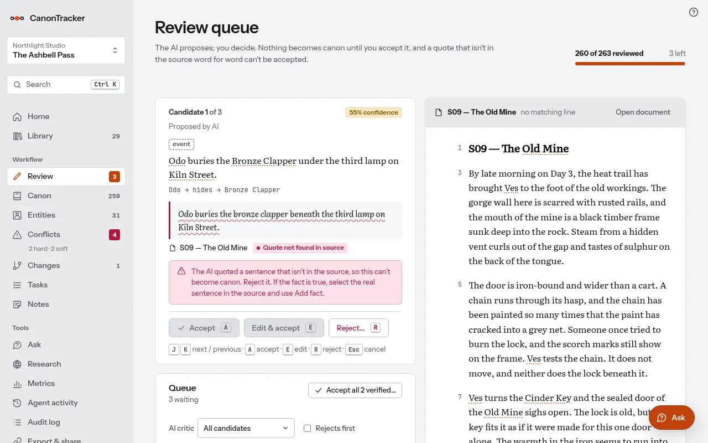
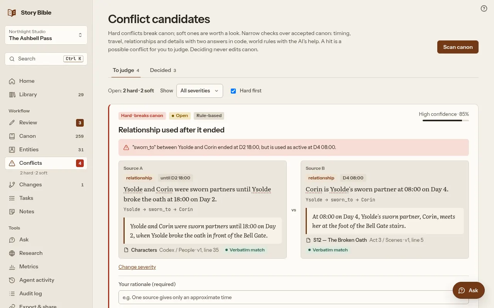
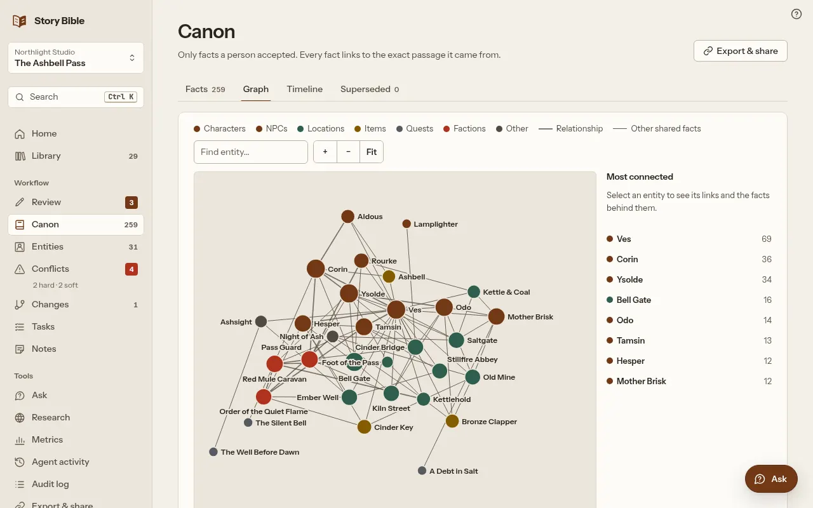

# CanonTracker

CanonTracker helps writers and narrative teams keep a story world consistent. Import lore, chapters, scripts or recordings; review AI-proposed facts with their source quotes; then check accepted canon for contradictions and inspect the 1–2 hop impact of a proposed change. People decide what becomes canon. It works for novels, games, screen stories and worldbuilding, solo or in a studio.

Meta AI Developer Hackathon · Startup track. **Demo video:** [youtu.be/uzPa375gpYU](https://youtu.be/uzPa375gpYU) · **Live app:** `LIVE_URL` (filled at submission). Use the local quick start to try it now.

## Built during the hackathon (27 Oct–4 Nov 2026)

Built by **Umurcan (Umur) Görür**, solo, at [TekTık](https://tektik.ai). The spec and first build from 27–30 Oct were committed as the **MVP baseline** on 30 Oct; repository history starts that day. The only pre-existing component is the generic CI/CD deployment pipeline reused for staging. The application, sample workflows and Meta integrations were built for this entry. See the [submission draft](docs/submission.md).

## How CanonTracker uses Meta

- **Muse Spark 1.3** extracts candidates, gives critic opinions, answers from canon and suggests world-rule violations. Bounded Responses agents combine web search with deterministic calculators for Research and call the app's own MCP read/check tools for Continuity.
- **Muse Voice Transcribe 1.0** turns recordings into timestamped transcripts and fills dictation in Write and Ask. Entity names are recognition hints; script comparison uses deterministic rules to check changed lines against canon.
- **Muse Image 1.0** creates editorial portraits and document covers; images never become canon evidence.
- **Muse Code** connects directly over MCP. CanonTracker's 37 MCP tools share the web app's permissions, validation and audit. Muse Spark API clients use the bridge script generated in Settings → Agents & API.

CanonTracker's own AI cannot accept canon, and neither can a connected agent: agents read canon, check facts and propose; a person decides in CanonTracker. Quotes are checked against stored passages; no evidence means `unknown`. Calls and tool steps are inspectable in Agent activity and Metrics. [Meta API notes](docs/meta-api-notes.md) document dated live observations, redacted responses, API constraints and reproducible contract tests.

## Run it (about 5 minutes, no API key)

Use **Node 24** and **pnpm 12.16.1** (`mise install` reads `mise.toml`, or install these versions yourself). Install **ffmpeg and ffprobe** for audio conversion, including the voice sample.

```sh
git clone https://github.com/tektikas/canontracker storybible
cd storybible
pnpm install
# Create .env from the example, filling the session password without printing it.
node -e "const fs = require('node:fs'); const crypto = require('node:crypto'); try { fs.writeFileSync('.env', fs.readFileSync('.env.example', 'utf8').replace('NUXT_SESSION_PASSWORD=', 'NUXT_SESSION_PASSWORD=' + crypto.randomBytes(24).toString('hex')), { flag: 'wx' }); } catch (error) { if (error.code !== 'EEXIST') throw error; console.error('.env already exists; keeping it unchanged.'); process.exit(1); }"
pnpm dev --port 3000
```

Open http://localhost:3000, then:

1. **Sign up** with a name, email and password of at least 8 characters; the data stays in a local SQLite file under `.data/`.
2. Name your studio and first project.
3. On the last onboarding step click **Load The Ashbell Pass** (28 documents), **Load Sherlock Holmes** (31 chapters/stories), **Load the Oz books** (69 chapters), **Load Alice** (24 chapters), or **Load demo and take the tour** (Broken Tide + Lantern Row).

Run the `.env` creation command once on a fresh clone. Keep the password stable for your sessions. An empty `NUXT_SESSION_PASSWORD` prevents sign-in; production needs at least 32 characters. `.env` and `.data/` are ignored by Git. Stop dev before starting the production build:

```sh
pnpm build
HOST=localhost PORT=3000 node --env-file=.env .output/server/index.mjs
```

The production server does not load `.env` itself; Node's `--env-file` supplies it. Persist `.data/` when self-hosting. Other samples, including Sherlock Holmes, the Oz books and Alice, are available in **Settings → Projects → your project**; a sample load replaces that project's content, retaining its audit trail.

## Recorded mode and live mode

- **Recorded (default, `NUXT_MODEL_MODE=mock`)**: model steps replay stored output only for matching sample text. Lantern Row preloads explicitly marked sample canon instead of extracting it. Your own files import but get no extraction output; add facts by hand from their text.
- **Live (`NUXT_MODEL_MODE=meta`)**: calls the Meta Model API with your key. A live failure (no key, 401, 402, timeout, invalid JSON) is shown and logged, and never falls back to recorded output.

Set `NUXT_MODEL_MODE=meta` and `NUXT_META_API_KEY` in your local `.env` or server environment. The product UI says “AI”; model IDs and recorded/live provenance stay in the developer trace. Replays log `mock:recorded-fixtures` as the model ID. See the sample provenance below for how those fixtures were made.

Optional: `NUXT_MODEL_ID` (default `muse-spark-1.3`), `NUXT_CRITIC_MODEL_ID` (empty uses the main model), `NUXT_IMAGE_MODEL_ID` (default `muse-image-1.0`), `NUXT_META_BASE_URL` (default `https://api.meta.ai/v1`), `NUXT_TRANSCRIBE_MODEL_ID` (default `muse-voice-transcribe-1.0`; `NUXT_TRANSCRIBE_BASE_URL` / `NUXT_TRANSCRIBE_API_KEY` default to the Meta ones). Audio conversion uses ffmpeg (the production image installs it). The key is read on the server only and never reaches the browser. Dated live results are in the Meta API notes; local recorded/contract checks do not establish current service availability or billing status.

## Meta AI in CanonTracker

The model adapter is `server/utils/model.ts`; multi-step Responses calls run in `server/utils/agent.ts`. The Meta Model API (`https://api.meta.ai/v1`, OpenAI-compatible) is called from the CanonTracker server. The optional MCP bridge runs on the user's machine with their own credentials.

| Agent | What it does | Meta model | Meta API | Runs |
| --- | --- | --- | --- | --- |
| Extractor | Reads an imported document and proposes fact candidates, each with a quote. Nothing becomes canon until a person accepts it. | Muse Spark 1.3 | Chat completions (`/chat/completions`, JSON output) | CanonTracker server |
| Rule checker | Tests a world rule against accepted canon and suggests `WORLD_RULE_VIOLATION` conflicts (labelled as model-suggested). | Muse Spark 1.3 | Chat completions | CanonTracker server |
| Ask / Canon | Answers a question from accepted canon only, with citations; no evidence means `unknown`. | Muse Spark 1.3 | Chat completions | CanonTracker server |
| Transcriber | Turns audio into text: recordings (voice-actor takes, table reads, interviews, voice notes) become read-only transcripts with a time on every passage (citations play "at 02:14"), and dictation fills the writer and Ask. Sends the project's entity names as recognition keywords. Script vs recording then flags changed or ad-libbed lines that contradict canon (deterministic rules, no model). | Muse Voice Transcribe 1.0 | Speech to text (`/asr/transcribe`, multipart WAV, ENDPOINTING turns, `keywords`) | CanonTracker server (audio converted with ffmpeg) |
| Illustrator | Generates entity portraits and document covers (editorial, never canon). | Muse Image 1.0 | Images (`/images/generations`) | CanonTracker server |
| MCP bridge | Relays Muse Spark function calls to the app's 37 MCP tools. Token level and the person's live role determine allowed actions; no token can make a canon decision, and edits with a full token are attributed to that person and marked via agent. Settings → Agents & API generates the bridge script. | Muse Spark 1.3 | Chat completions with function calling | User's machine (script); `/mcp` on the server |
| Research | Answers real-world questions with a verdict, quotes checked on fetched pages and deterministic calculators (physics, sky, calendars, period travel, time since death). A bounded agent; results are research notes, promoted to canon only through review. | Muse Spark 1.3 | Responses API (`/responses`), built-in `web_search` and function calling | CanonTracker server |
| Critic | Gives a second opinion on each verified candidate in Review: keep / reject / needs edit, a reason (figurative, not stated in the passage, ambiguous time or place, duplicate of a canon fact, wrong subject) and one line why, plus a corrected fact for "needs edit". It reads the candidate, its source passage and nearby canon; it never sees a blocked candidate, never writes a quote and never changes a fact. Review filters and sorts by it and offers "Accept N the AI critic keeps" (still one human confirmation). | Muse Spark 1.3 | Chat completions (JSON output) | CanonTracker server, in batches after extraction and on demand |
| Continuity | Checks a draft, selected passage or Ask text against canon using the app's own MCP read/check tools. Reports sentences, cited facts, rule-engine hits and suggested fixes that are never applied. The server grounds every finding; Agent activity shows each step. | Muse Spark 1.3 | Responses API (`/responses`) with function calling | CanonTracker server |

## Screenshots







## Rules the app enforces

- **Human gate:** the model and connected agents only propose candidates. Canon decisions are explicit, made by a person in the app, and attributed to them; MCP refuses every decision for every token.
- **Verbatim citations:** every canon fact has at least one evidence row whose quote appears word for word in a passage of an imported document. Hallucinated quotes are blocked.
- **Versions stay intact:** uploads and edits create new versions; earlier source text stays unchanged and affected citations need re-checking. Uploaded and written documents can be edited in the app as new versions. Recording transcripts cannot. Word `.docx` is converted on upload and the original file kept.
- **No evidence, no answer:** the answer is `unknown`. Change proposals, conflict candidates and possible review impact are three separate things; impact stays inside accepted canon, at most 2 hops, with path, evidence and rationale.

## Samples

- **Broken Tide:** original island story, 2 lore documents and 11 scenes, with planted contradictions and a guided tour.
- **Lantern Row:** three short documents with five preloaded sample canon facts and one planted conflict.
- **The Ashbell Pass:** 28 documents (about 22.5k words) with folders, NPCs and quests, for a larger-scale run. To try voice in recorded mode, drop `public/samples/harl-crier-take.wav` (a synthetic text-to-speech take of the town crier's lines, with one ad-libbed line) on the Library, open it and choose **Compare with a script** → "Dialogue: The Town Crier". First accept the Review candidate “Captain Rourke stands watch at the Bell Gate from 21:00 to 22:00 on Day 2.” to see the ad-lib flagged against canon. In recorded mode only this file has a transcript.

- **Sherlock Holmes:** 31 chapters/stories (about 127k words), public-domain Doyle texts, recorded candidates and known continuity slips. Text and illustration credits: [SOURCES.md](server/assets/sherlock-holmes/SOURCES.md).
- **The Oz books:** L. Frank Baum's The Wonderful Wizard of Oz, The Marvelous Land of Oz and Ozma of Oz, 69 chapters (about 119k words), public domain, recorded candidates and wiki pages for the cast; no gold set. Credits: [SOURCES.md](server/assets/oz/SOURCES.md).
- **Alice:** Lewis Carroll's Alice's Adventures in Wonderland and Through the Looking-Glass, 24 chapters (about 56k words), public domain, recorded candidates and wiki pages for the cast; no gold set. Credits: [SOURCES.md](server/assets/alice/SOURCES.md).


Authenticated `POST /api/demo/load` takes `{ "set": "broken-tide" }`, `lantern-row`, `ashbell-pass`, `sherlock-holmes`, `oz` or `alice` and replaces the current project's data (admin and above). Sign up and select a project first; an unauthenticated curl is refused.

## Connect an agent over MCP

1. Sign in, open **Settings > Agents & API** and create a token (shown once, bound to one project). Pick its level: **propose** (reads, checks and proposes; nothing it does becomes canon) or **full** (also editorial edits as you within your role, shown as "via agent"). Neither level decides canon: a person accepts, rejects, applies changes, judges conflicts and merges in the app.
2. Point an MCP client at `http://localhost:3000/mcp` (Streamable HTTP) and send `Authorization: Bearer sb_...` with every request.
3. 37 tools: 16 canon and document tools (search facts, context pack, entities, timeline, `sb_ask`, `sb_check_facts`, conflicts, impact, ...) and 21 area tools for reading, proposing and editorial work (review queue, entities, change proposals, conflict scan, documents, notes, library, research, continuity, export, ...). Canon decisions, team changes, tokens, sample loads and audio uploads stay in the app. Empty results mean `unknown` or "no impact found".

**Muse Code** connects directly; add this to `~/.config/muse/settings.json`, supply `STORYBIBLE_TOKEN` in your environment and run `/mcp`:

```json
{
  "schema_version": 1,
  "mcp_servers": {
    "canontracker": {
      "transport": "streamable_http",
      "url": "http://localhost:3000/mcp",
      "headers": { "Authorization": "Bearer ${STORYBIBLE_TOKEN}" }
    }
  }
}
```

The settings page generates ready-made snippets with your token for Muse Code, the Muse Spark API (a small bridge script), Claude Code and Cursor.

## Architecture

Nuxt 4 (SSR pages and the Nitro API in one process), SQLite through Node's built-in `node:sqlite` with no ORM (file at `.data/storybible.db`), `nuxt-auth-utils` sealed-cookie sessions with studios, roles (owner, admin, editor, viewer) and projects. One middleware (`server/middleware/access.ts`) guards every content route and scopes each query to the current project. Documents are split into passages; model output passes through `server/utils/model.ts` and a single verbatim quote check before a human reviews it. `/mcp` exposes the same data to agents. `audit_events` is append-only.

## Checks

Run the full serial gate:

```sh
pnpm check
```

Runs typecheck, production build, every `scripts/*-check.*`, all HTTP probes against isolated production servers, migrations, seeded merge fuzzing, Meta contract replay and research replay, serially. No live key or working tree `.data/` is used. Requires `ffmpeg`, `ffprobe`, `unzip`, `xmllint`, `openssl`, `ss` and Git with full history for migration fixtures. Uses **4650/4651** by default; override with `CHECK_PORT=4700 pnpm check`. Logs stay in a printed temporary directory; failures exit nonzero. [docs/checks.md](docs/checks.md) lists individual commands and coverage.

Browser QA is separate, using `playwright-cli` at desktop and mobile sizes. Recorded and stubbed checks are not live Meta verification.

## More

[ROADMAP.md](ROADMAP.md) lists what is not built yet. The pitch deck (market, business model, go-to-market, team) is [docs/pitch-deck.pdf](docs/pitch-deck.pdf), also on the site at `/pitch`; every number on it has a numbered source in its appendix. [docs/meta-api-notes.md](docs/meta-api-notes.md) is what we ran into building on the Meta Model API, with the recorded responses that show it and our suggestions. [AGENTS.md](AGENTS.md) describes the data model and invariants in detail.

## License

CanonTracker is open source under the [GNU Affero General Public License v3.0 or later](LICENSE). You may self-host, change and share it; if you run a modified version as a network service, you must offer its users the source of that version.
